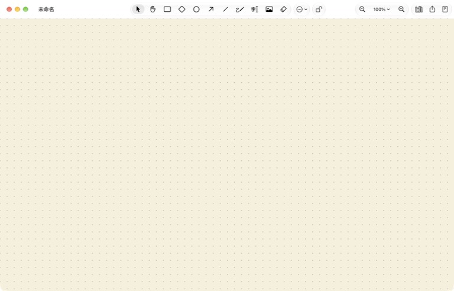

# Sketchpad

A native macOS whiteboard built around [Excalidraw](https://github.com/excalidraw/excalidraw), with a
reader for the PDFs you are taking notes on.



- **A Mac app, not a web page.** SwiftUI document windows, a native toolbar and menus, the system
  accent color, Liquid Glass styling and app icon. The board itself is the official
  `@excalidraw/excalidraw` package running in a `WKWebView`, fully offline.
- **Standard `.excalidraw` files.** Boards open on excalidraw.com and vice versa.
- **Read PDFs beside the board** (in the spirit of Heptabase): insert a PDF as a card (or drop one on
  the canvas), open it in a reader panel on the right, select text and press ⌘B to turn it into a
  quote card, or ⌘-drag to capture a figure. Cards link back to their page, and the reader highlights
  what you have already quoted. PDFs stay where they are (a Zotero folder, say); the board keeps a
  bookmark to each file and never writes into it.
- **Reading-friendly canvas**: paper, sepia, gray and green backgrounds, with an optional dot or
  square pattern; clean lines and a plain font by default for new shapes.

The interface is in Traditional Chinese (繁體中文).

## Requirements

- macOS 15 or later to run it.
- To build it: **Xcode 26 or later** (the app icon is an Icon Composer document, and the code uses
  Swift 6.2 features), [Homebrew](https://brew.sh) and **Node.js** with npm. Tested with Xcode 27.2,
  Node 24 and XcodeGen 2.46 on macOS 27.
- No Apple developer account: the app is signed ad hoc on the Mac that builds it, so it opens without
  Gatekeeper warnings there.

## Install

```bash
git clone https://github.com/Mopsh1/sketchpad.git
cd sketchpad
make deps      # brew install xcodegen; npm ci for the web layer
make install   # build a Release copy and put it in /Applications
open -a Sketchpad
```

To update later: `git pull && make install` (quit Sketchpad first, saving your boards).

Other commands: `make test` (unit tests), `make run` (build and open without installing),
`make icon` (render the app icon in every appearance into `build/icon-preview`).

## For AI agents: deploying on a Mac

If you are an agent asked to install Sketchpad on this Mac, follow these steps in order and check each
result before going on. Steps marked **human** need the user's password or a decision; ask the user to
do them rather than working around them.

1. **Check the tools.**
   - `xcodebuild -version` must print Xcode 26 or later. If it fails or names an older Xcode, the user
     needs to install Xcode from the App Store (**human**).
   - `xcode-select -p` must point inside `Xcode.app` (for example
     `/Applications/Xcode.app/Contents/Developer`), not `/Library/Developer/CommandLineTools`. If not,
     the user runs `sudo xcode-select -s /Applications/Xcode.app` (**human**).
   - If `xcodebuild` reports an unaccepted license, the user runs `sudo xcodebuild -license accept`
     (**human**). On a fresh Xcode, also run `xcodebuild -runFirstLaunch`.
   - `brew --version` and `node --version` must succeed. Install what is missing (Homebrew's installer
     asks for the password: **human**; `brew install node` otherwise).
2. **Get the source.** `git clone https://github.com/Mopsh1/sketchpad.git && cd sketchpad`, or
   `git pull` in an existing clone.
3. **Install dependencies.** `make deps`. Expect npm to finish with `added … packages`.
4. **Close the running app, if any.** `make install` replaces `/Applications/Sketchpad.app`. If
   Sketchpad is running, ask the user to save their boards and quit it. Never quit it in a way that
   discards changes (such as AppleScript `quit saving no`): unsaved untitled boards are lost for good.
5. **Build and install.** `make install`. It takes a few minutes the first time. Expect
   `** BUILD SUCCEEDED **` and then `Installed /Applications/Sketchpad.app`. Any `error:` line means
   the build failed; report it with the lines around it.
6. **Verify.**
   - `/usr/libexec/PlistBuddy -c "Print :CFBundleIdentifier" /Applications/Sketchpad.app/Contents/Info.plist`
     prints `com.mopshi.Sketchpad`.
   - `open -a Sketchpad` opens a blank untitled board with the toolbar at the top of the window.
   - Optionally `make test`: expect `Test run with … tests … passed` and `** TEST SUCCEEDED **`.

## How it is built

```
web/          Vite + React + TypeScript: the Excalidraw page and its bridge to Swift
Sketchpad/    SwiftUI app: document windows, toolbar and menus, PDF reader (PDFKit), WKWebView host
project.yml   XcodeGen spec; Sketchpad.xcodeproj is generated from it
```

The page is served to the web view from inside the app bundle over a custom `sketchpad://` scheme, so
nothing is fetched from the network. Swift and the page talk through `WKScriptMessageHandler`; the
message format is described at the top of `web/src/bridge.ts`.

## Credits and license

The whiteboard is [Excalidraw](https://github.com/excalidraw/excalidraw) (MIT), used as an npm package
without modification. Sketchpad itself is released under the [MIT License](LICENSE).

---

## 中文說明

Sketchpad 是以 Excalidraw 為核心的 macOS 原生白板 App：

- 原生工具列與選單、Liquid Glass 外觀。
- 標準 `.excalidraw` 檔案，和 excalidraw.com 互通。
- 參考 Heptabase 的 PDF 閱讀：
  - PDF 卡片＋右側閱讀面板。
  - 選取文字按 ⌘B 變成引文卡片，按住 ⌘ 拖曳可以擷取圖表。
  - 卡片可以跳回原文。PDF 留在原地，不會被修改。
- 適合閱讀的背景色，以及點點／方格背景。

安裝方式見上方的 Install。要交給 AI agent 部署時，請它照「For AI agents」一節逐步執行。
